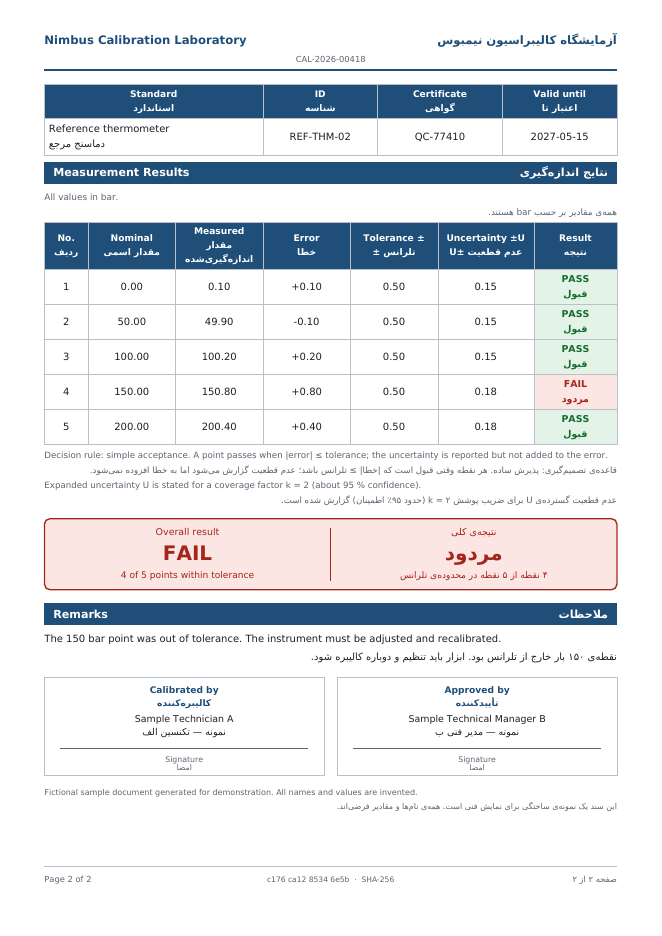
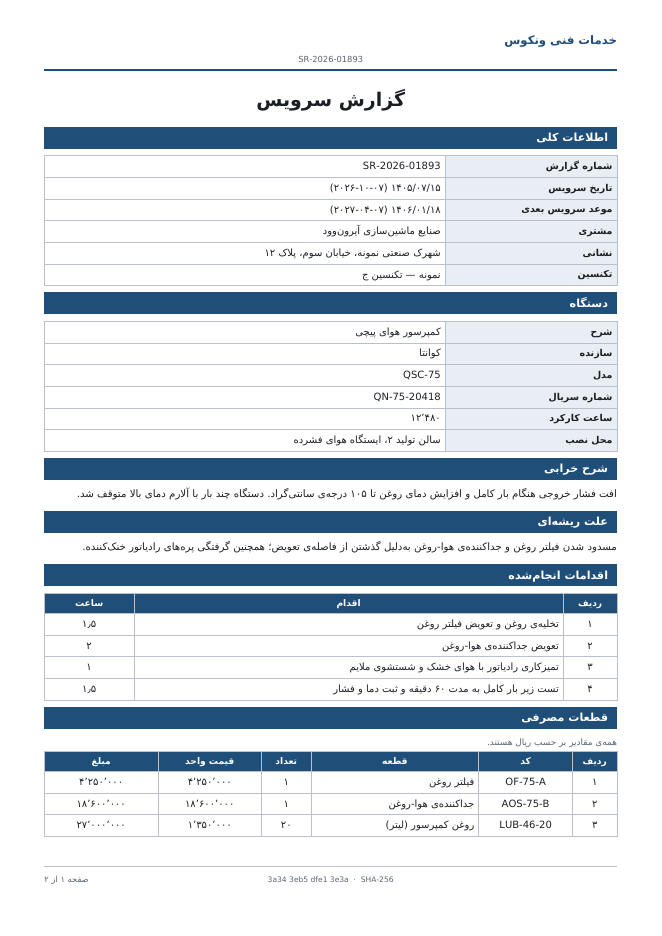

# service-report-pdf-fa

Bilingual **Persian / English** PDF documents for industrial equipment — a **calibration certificate**
and a **service report** — rendered right-to-left with Jalali dates, Persian digits and amounts written
out in words.

The interesting part: `reportlab` cannot shape or reorder Arabic-script text, so this project ships a
small **shaping + bidi engine in pure Python (standard library only)**, with tests. The only runtime
dependency is `reportlab`.

> All companies, people, serial numbers and values are **fictional** (Nimbus, Ironwood, Helix, Vortex,
> Quanta). Each generated PDF says so in its last line.

| Calibration certificate (both languages, page 2) | Service report (Persian only, page 1) |
|---|---|
|  |  |

Ready-made outputs are in [`samples/`](samples) (9 PDFs: 3 documents × `fa` / `en` / `both`).

## Quick start

```bash
uv sync
uv run service-report demo -o out                     # all 9 sample PDFs (needs the repo checkout: reads examples/
uv run service-report certificate examples/certificate_fail.json -o cert.pdf --lang both
uv run service-report report examples/service_report.json -o report.pdf --lang fa --digits fa
uv run service-report jalali 2026-10-08               # -> 1405/07/16
uv run service-report words 80113000
```

```
$ service-report words 80113000
هشتاد میلیون و صد و سیزده هزار
eighty million one hundred thirteen thousand
```

## Options

| flag | values | meaning |
|---|---|---|
| `--lang` | `fa`, `en`, `both` (default) | `both` prints every label and text twice: `[English label │ value │ Persian label]` |
| `--digits` | `auto` (default), `fa`, `en` | `auto`: each line uses its own language's digits. Pure-Persian output uses Persian digits and `٬` / `٫` separators |

## What each document contains

**Calibration certificate** — certificate number, dates in Gregorian *and* Jalali, customer, instrument,
environmental conditions, reference standards, a measurement table (nominal, measured, error, tolerance,
uncertainty, **computed** PASS/FAIL per point), an overall verdict, decision rule, signatures, and a
SHA-256 fingerprint of the input data in the footer and the PDF metadata. Two examples: one all-pass, one
with a rejected point.

**Service report** — machine data, reported problem and root cause, actions with hours, parts with
quantity × unit price, labor, VAT, total, and the **total in words** (Persian and English). Money is exact
(`Decimal`, whole rials, half-up rounding).

Input is plain JSON, see [`examples/`](examples). Bilingual text fields are `{"fa": "...", "en": "..."}`.

## How it works

```
logical text ──► textnorm ──► wrap (logical words) ──► shaping ──► bidi ──► drawString (left→right)
                 ي→ی  ك→ک     greedy, measured with      presentation   UAX#9 subset   reportlab canvas
                 tatweel       the shaped glyph widths    forms
```

* `textnorm` – Arabic → Persian letter variants, digit conversion, ZWNJ kept.
* `shaping` – isolated/initial/medial/final forms and lam-alef. **The form tables are derived from
  `unicodedata.decomposition`** of the Arabic Presentation Forms blocks at import time; nothing is typed by
  hand. ZWNJ breaks joining and is removed afterwards; ZWJ forces it.
* `bidi` – rules W1–W7, N1–N2, I1–I2, L1, L2, L4 (mirroring), auto/LTR/RTL paragraph direction.
* `jalali` – 33-year arithmetic calendar, supported for years 1200–1600 (raises outside that range).
* `numwords` – integers to Persian / English words.
* `layout` – a small canvas layout engine: tables with repeated headers across pages, "page x of y"
  (two-pass canvas), verdict box, signature boxes. `invariant=1`, so **the same input gives byte-identical PDFs**.

```
>>> shaping.shape("سلام")                 # logical -> presentation forms
'ﺳﻼﻡ'
>>> bidi.visual("سال ۱۴۰۵", "rtl")        # number stays left-to-right inside RTL text
'۱۴۰۵ لاس'
```

## Tests

123 test cases (`uv run pytest`):

* **jalali**: the five reference conversions in both directions, every day from 1960 to 2060 round-trips,
  year boundaries are continuous, invalid dates rejected.
* **shaping / bidi**: reference words, ZWNJ/ZWJ, lam-alef, transparent marks, numbers with separators,
  identifiers (`SN-2026-0042`), mirroring, rule L1.
* **calibration / money**: inclusive tolerance boundary, `Decimal` exactness, guard-band rule, half-up
  rounding (2502.5 → 2503, not banker's rounding), validation errors.
* **PDF output**: glyph positions are read back with `pdfplumber` and compared with what the engine should
  have drawn; every glyph that is drawn exists in the bundled fonts; page numbers equal the real page count;
  an 80-row table paginates and repeats its header; output is reproducible; the CLI returns exit code 2
  for bad data.

I also ran a **mutation check**: 15 deliberate bugs (wrong leap rule, no ZWNJ handling, no mirroring,
`<` instead of `<=`, banker's rounding, last page not flushed, …). Two initially survived (rule L1 for
tabs, per-language digits); tests were added and all mutants are now caught.

## Limitations (read before using for real documents)

* **Text extraction.** Text in the PDF is stored as *presentation forms in visual order*. Copy/paste, search
  and accessibility are therefore limited, and some extractors re-run their own bidi logic and scramble digit
  runs (pypdf did, pdfplumber's position-based reading does not — the tests use the latter). For production
  documents use a HarfBuzz-based engine (for example WeasyPrint), which keeps the logical text.
* **Shaping scope.** Joining forms and lam-alef only. No kerning, no GPOS mark positioning (diacritics are
  stripped by the layout), no other ligatures.
* **Bidi scope.** No explicit embeddings/isolates (removed) and no rule N0 (paired brackets are mirrored but
  not resolved as a pair).
* **Font.** DejaVu Sans (regular and bold, license in `fonts/`) is bundled because it contains every
  presentation form needed. Its look is generic. Another font only works if its cmap contains the
  Arabic Presentation Forms code points; run `test_every_drawn_glyph_exists_in_the_font` after swapping.
  `٫` (decimal separator) is drawn small and comma-like in DejaVu.
* **Jalali.** Arithmetic rule, 1200–1600 only.
* **Decision rules.** `simple` and `guard_band` only; this is a layout demo, not an ISO/IEC 17025 template.

## Development

```bash
uv sync
uv run pytest
uv run ruff check
```

## License

MIT (see `LICENSE`). DejaVu fonts: see `src/service_report/fonts/LICENSE-DejaVu.txt`.
